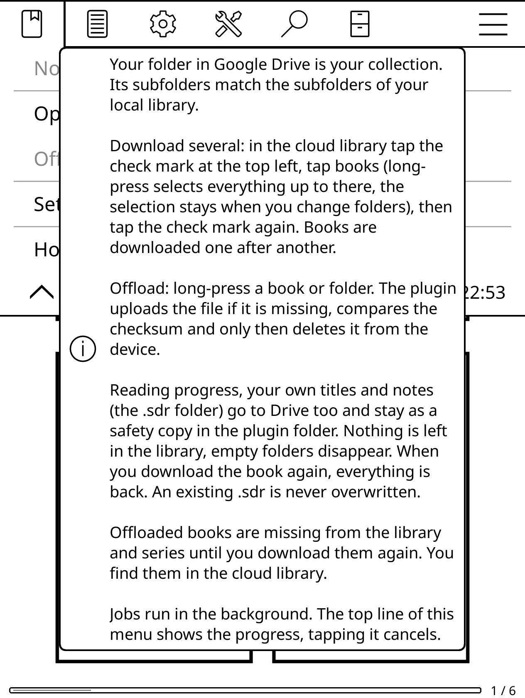
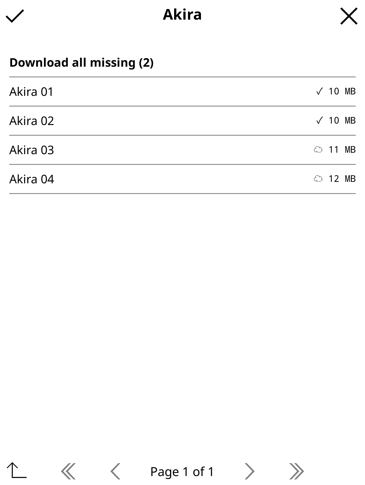
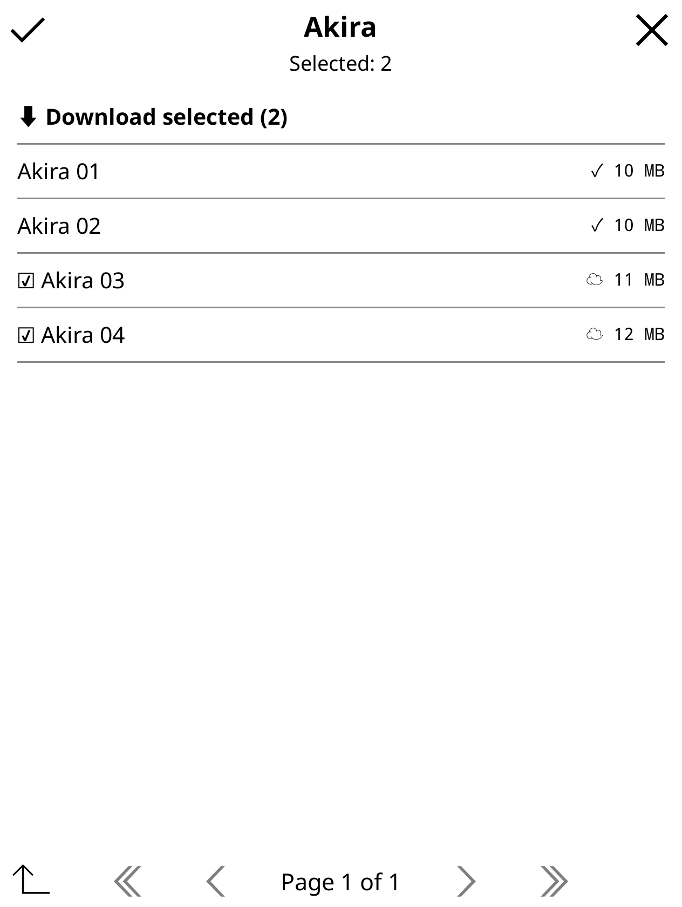
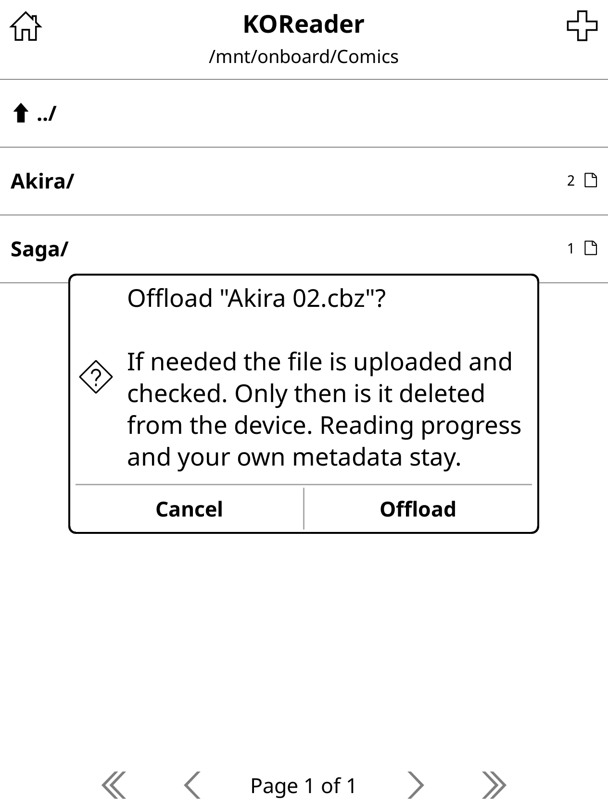
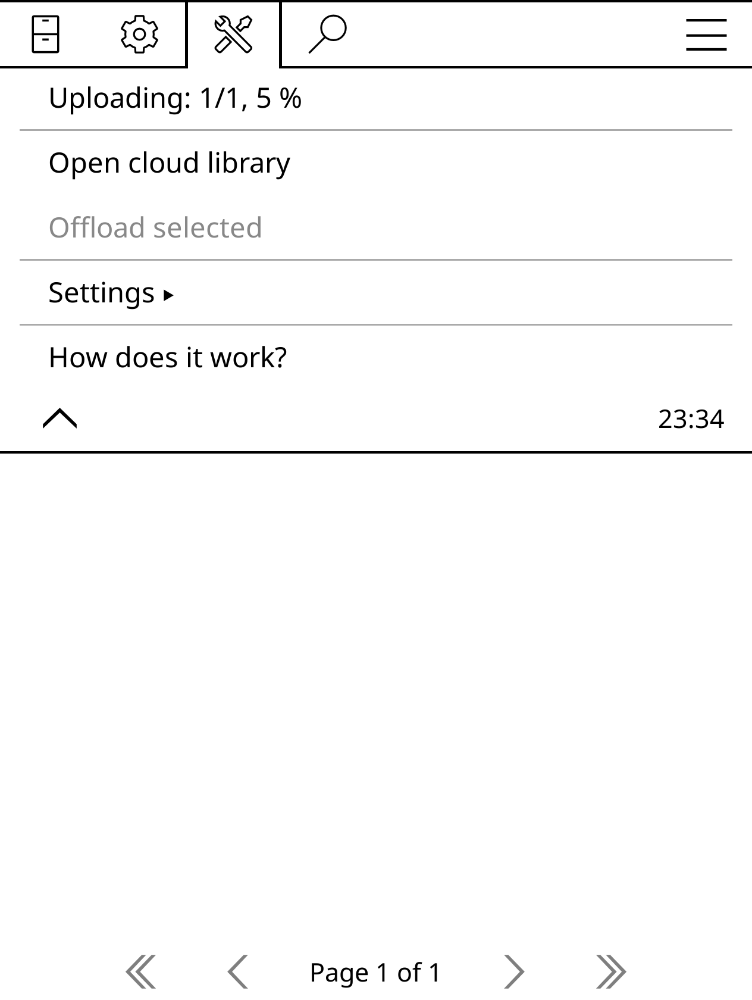
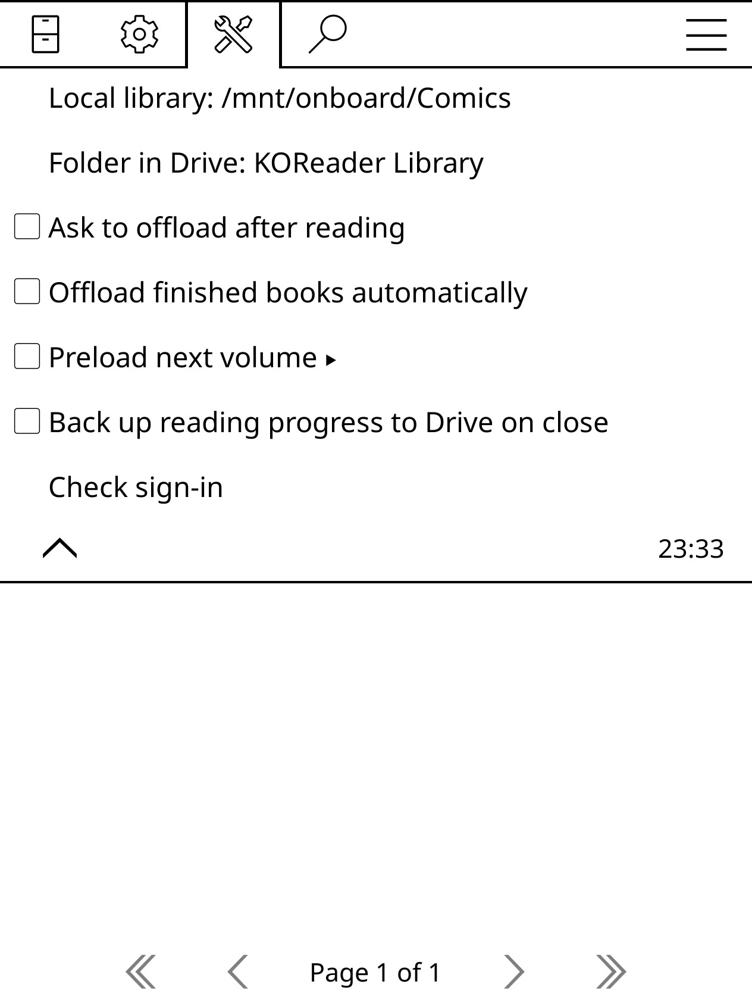
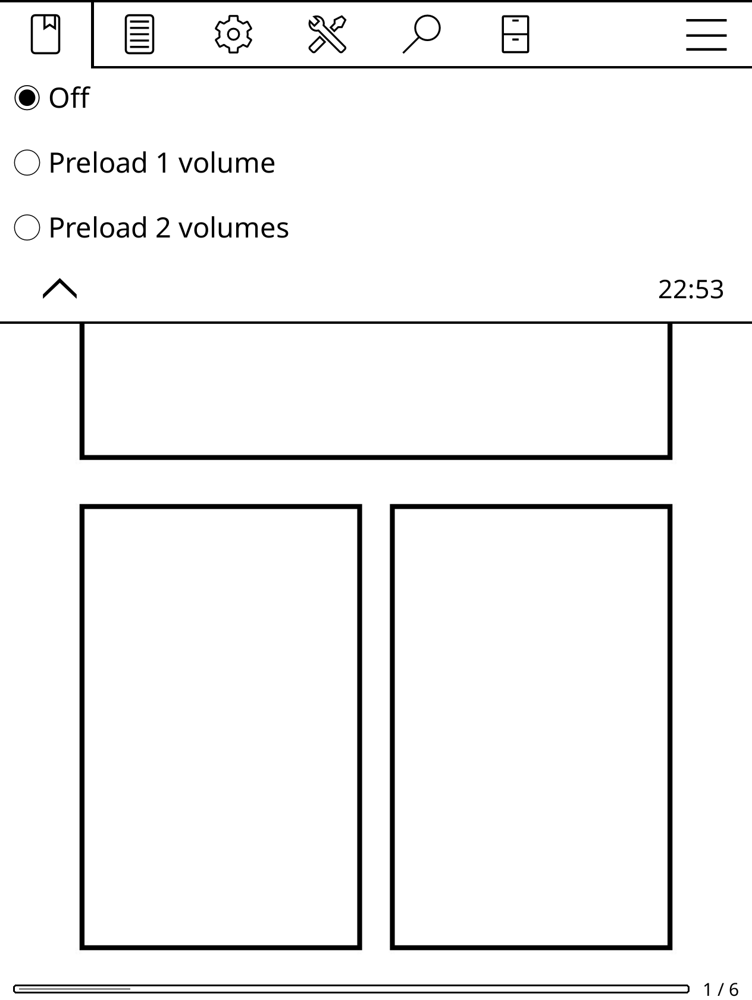

# Drive-Bibliothek für KOReader

*English: [README.md](README.md)*

<!-- lang-note -->
*Funktioniert auf **Deutsch und Englisch**: Menüs und Texte richten sich nach der KOReader-Sprache.*

Google Drive als Cloud-Bibliothek: Bücher und Comics vom Gerät auslagern und bei Bedarf wieder herunterladen. Lesestand und eigene Angaben bleiben erhalten.

## Bildschirmfotos

*Die Bildschirmfotos zeigen die englische Oberfläche; in einem deutschen KOReader sind die Texte deutsch.*

<table>
<tr><td align="center" valign="top" width="33%"><br><sub>Menü der Drive-Bibliothek</sub></td><td align="center" valign="top" width="33%"><br><sub>Meldung, solange die Anmeldung fehlt</sub></td><td align="center" valign="top" width="33%"><br><sub>Hilfetext zu Herunterladen, Auslagern und Hintergrund-Aufträgen</sub></td></tr>
<tr><td align="center" valign="top" width="33%"><br><sub>Cloud-Bibliothek: der Drive-Ordner</sub></td><td align="center" valign="top" width="33%"><br><sub>Eine Reihe: auf dem Gerät (Haken) oder nur in der Cloud (Wolke)</sub></td><td align="center" valign="top" width="33%"><br><sub>Auswahl-Modus: Ausgewählte herunterladen</sub></td></tr>
<tr><td align="center" valign="top" width="33%"><br><sub>Rückfrage vor dem Auslagern eines Buchs</sub></td><td align="center" valign="top" width="33%"><br><sub>Statuszeile beim Hochladen</sub></td><td align="center" valign="top" width="33%"><br><sub>Einstellungen</sub></td></tr>
<tr><td align="center" valign="top" width="33%"><br><sub>Nächsten Band vorladen: aus, 1, 2</sub></td></tr>
</table>

## Was es macht

- **In Cloud auslagern:** Lang auf ein Buch oder einen Ordner drücken. Das Plugin lädt die Datei hoch, falls sie noch fehlt, vergleicht die Prüfsumme und löscht sie erst danach vom Gerät.
- **Cloud-Bibliothek:** Werkzeuge → Drive-Bibliothek. Zeigt den Drive-Ordner und bei jedem Buch, ob es nur in der Cloud (☁) oder auch auf dem Gerät (✓) liegt. Antippen lädt es herunter oder öffnet es.
- **Mehrere auf einmal:** Im Auswahl-Modus Bücher markieren, dann Werkzeuge → Drive-Bibliothek → „Ausgewählte auslagern“ oder die Geste dafür.
- **Optional:** Nach dem Schließen eines fertig gelesenen Buchs fragen, ob es ausgelagert werden soll.

Deine **lokale Bibliothek** ist dein KOReader-Home-Ordner, also der Ordner, in dem deine Bücher liegen. Unter Einstellungen → „Lokale Bibliothek“ kannst du einen anderen wählen.

Der Ordner in Drive heißt standardmäßig `KOReader Library`. Seine Unterordner entsprechen denen der lokalen Bibliothek. Lädst du am PC selbst hoch, nimm dieselben Ordnernamen, dann erkennt das Plugin die Dateien und lädt sie nicht doppelt hoch.

## Installation

1. ZIP aus den [Releases](../../releases) laden und entpacken, oder das Projekt herunterladen.
2. Den Ordner **`drivelibrary.koplugin`** nach `koreader/plugins/` kopieren (auf dem Kobo zum Beispiel `.adds/koreader/plugins/`).
3. KOReader neu starten und die Einrichtung unten durchgehen.

## Wichtig zu wissen

- **Der `.sdr`-Ordner (Lesestand, eigene Titel, Notizen) geht beim Auslagern mit nach Drive** und bleibt zusätzlich als Sicherheitskopie in `.adds/koreader/drivelibrary/sdr/`. In der Bibliothek bleibt nichts zurück, leere Ordner verschwinden. Beim Herunterladen kommt die `.sdr` zurück; eine vorhandene `.sdr` wird nie überschrieben.
- **Ausgelagerte Bücher fehlen in Bibliothek und Reihen**, bis du sie wieder herunterlädst.
- **Es wird nie etwas überschrieben.** Liegt in Drive eine andere Datei mit demselben Namen, bleibt die lokale Datei liegen und du bekommst eine Meldung.
- **Das Plugin braucht vollen Zugriff auf dein Drive**, sonst sieht es keine Dateien, die du im Browser hochlädst. Es arbeitet nur im gewählten Ordner, das stellt aber nur der Code des Plugins sicher, nicht Google. Geht das Gerät verloren: Zugriff unter myaccount.google.com/permissions entziehen.

## Einrichtung (einmalig)

Das machst du nur einmal, es dauert etwa 10 bis 15 Minuten. Am besten am Computer.

Am Ende hast du **zwei kleine Dateien** und kopierst sie auf den E-Reader:

| Datei | Wozu | bekommst du in |
| --- | --- | --- |
| `client_id.json` | kennzeichnet dein eigenes Google-Projekt | Teil 1 |
| `refresh_token.txt` | lässt das Plugin in dein Drive | Teil 2 |

Alles ist kostenlos. Du brauchst ein eigenes kleines „Projekt“ bei Google, damit außer dir niemand Zugriff auf dein Drive hat.

### Teil 1: Dein Google-Projekt anlegen

Melde dich mit dem Google-Konto an, dessen Drive du benutzen willst.

**1. Projekt anlegen**
- [console.cloud.google.com/projectcreate](https://console.cloud.google.com/projectcreate) öffnen
- Name: `KOReader Drive` → **Erstellen**
- Prüfe, dass dieses Projekt für die nächsten Schritte oben auf der Seite ausgewählt ist.

**2. Google Drive einschalten**
- [Seite der Google Drive API](https://console.cloud.google.com/apis/library/drive.googleapis.com) öffnen
- **Aktivieren** klicken

**3. Zustimmungsbildschirm einrichten** (die Seite „Möchtest du dieser App Zugriff erlauben?“)
- [Zustimmungsbildschirm](https://console.cloud.google.com/apis/credentials/consent) öffnen
- Zielgruppe: **Extern**
- App-Name (z. B. `KOReader Drive`) und deine E-Mail-Adresse eintragen, speichern
- **App veröffentlichen** klicken, sodass der Status **In Produktion** ist

> Das Veröffentlichen nicht auslassen. Im Status „Test“ läuft deine Anmeldung nach 7 Tagen ab. Eine Prüfung durch Google ist für den eigenen Gebrauch nicht nötig.

**4. Erste Datei erzeugen: `client_id.json`**
- [Anmeldedaten](https://console.cloud.google.com/apis/credentials) öffnen
- **Anmeldedaten erstellen** → **OAuth-Client-ID**
- Anwendungstyp: **Webanwendung**
- Unter **Autorisierte Weiterleitungs-URIs** genau diese Adresse hinzufügen:
  ```
  https://developers.google.com/oauthplayground
  ```
- **Erstellen**, dann die **JSON-Datei herunterladen**
- Die heruntergeladene Datei in `client_id.json` umbenennen

Lass das Fenster offen: **Client-ID** und **Clientschlüssel** brauchst du in Teil 2.

### Teil 2: Zugriff auf dein Drive erlauben

So entsteht die zweite Datei, mit einem Werkzeug von Google namens „OAuth Playground“.

**5. Eigenes Projekt eintragen**
- [developers.google.com/oauthplayground](https://developers.google.com/oauthplayground) öffnen
- Oben rechts auf das **Zahnrad** klicken
- Haken bei **Use your own OAuth credentials** setzen
- **Client-ID** und **Clientschlüssel** einfügen

**6. Zugriff erlauben**
- Links in das Feld **Input your own scopes** einfügen:
  ```
  https://www.googleapis.com/auth/drive
  ```
- **Authorize APIs** klicken und anmelden
- Google warnt „Google hat diese App nicht überprüft“. Das ist normal, es ist deine eigene App: **Erweitert** → weiter
- Zugriff erlauben

**7. Zweite Datei erzeugen: `refresh_token.txt`**
- **Exchange authorization code for tokens** klicken
- Den **Refresh token** kopieren (nur diesen, nicht den Access token)
- In eine neue Textdatei einfügen und als `refresh_token.txt` speichern

### Teil 3: Auf den E-Reader kopieren

**8. Beide Dateien in einen neuen Ordner `drivelibrary`** im KOReader-Ordner legen. Auf dem Kobo ist der KOReader-Ordner `.adds/koreader/` (versteckter Ordner).

```
koreader/
├── drivelibrary/                ← diesen Ordner anlegen
│   ├── client_id.json
│   └── refresh_token.txt
└── plugins/
    └── drivelibrary.koplugin/   ← das Plugin (siehe Installation)
```

> Die zwei Dateien gehören **nicht** in den Plugin-Ordner.

**9. Ausprobieren**
- KOReader neu starten, WLAN verbinden
- Werkzeuge → **Drive-Bibliothek** → **Einstellungen** → **Anmeldung prüfen**
- Der Ordner `KOReader Library` wird jetzt in deinem Drive angelegt, falls er fehlt. Fertig!

### Wenn etwas nicht klappt

| Problem | Lösung |
| --- | --- |
| „Noch nicht angemeldet“ | Ordnername, beide Dateinamen und den Ort prüfen (nicht im Plugin-Ordner). Unter Windows darf die Datei nicht `refresh_token.txt.txt` heißen. |
| `redirect_uri_mismatch` im Playground | Die Adresse aus Schritt 4 fehlt oder hat einen Tippfehler. |
| Geht nach 7 Tagen nicht mehr | Die App wurde nicht veröffentlicht (Schritt 3). Veröffentlichen, dann Schritt 5 bis 7 wiederholen. |
| Geht nach Monaten ohne Benutzung nicht mehr | Unbenutzter Zugang läuft nach 6 Monaten ab. Schritt 5 bis 7 wiederholen und `refresh_token.txt` ersetzen. |

## Sicherheit

Die Verbindung zu Google läuft mit geprüftem Zertifikat. `client_id.json` und `refresh_token.txt` sind wie Passwörter: nicht teilen, nicht veröffentlichen.

## Danksagung

Die Idee, den Zugang über den OAuth Playground zu holen, stammt aus [gdrive.koplugin](https://github.com/moohaad/gdrive.koplugin) von moohaad (MIT). Code wurde nicht übernommen.

## Getestet auf

Kobo Libra Colour mit KOReader 2026.07.1 und ZenOS. Die automatischen Tests laufen gegen ein nachgebautes Drive (`tests/fake_drive.py`), dazu wurde alles mit einem echten Drive-Konto von Hand geprüft.

## Wer das gemacht hat

Der Code wurde vollständig von **Claude** geschrieben, einer KI von Anthropic (in Claude Code). Der Besitzer dieses Projekts hatte die Idee, hat das Plugin auf dem Kobo getestet und Rückmeldungen gegeben, aber keinen Code geschrieben.

Es gibt keine Gewährleistung und keinen festen Support. Fehlermeldungen gern als [Issue](../../issues), bitte mit der `crash.log` aus dem KOReader-Ordner. **Vorsicht:** Das Plugin löscht Dateien vom Gerät (erst nach bestandener Prüfsumme). Probiere es zuerst mit Büchern, die du ersetzen kannst.

## Weitere Plugins

- [Comic Display](https://github.com/Akrota/koreader-comic-display): Refresh gegen Ghosting, dunkle Ränder und Uhr für Comics
- [Levels / Tonwerte](https://github.com/Akrota/koreader-comic-levels): Tonwertkurve für Comics
- [Comic Panel Zoom](https://github.com/Akrota/koreader-comic-panel-zoom): Panel-für-Panel-Ansicht (Fork von JorgeTheFox)
- [Comic Dual Page](https://github.com/Akrota/koreader-comic-dual-page): Doppelseiten mit Erkennung (Fork von KORComic)
- [CBZ Converter](https://github.com/Akrota/koreader-cbz-converter): Comics, PDF und EPUB auf dem Gerät in CBZ umwandeln
- [Folder to series](https://github.com/Akrota/koreader-folder-to-series): Comic-Ordner zu Reihen mit Bandnummern
- [Story Recall](https://github.com/Akrota/koreader-story-recall): Spoilerfreier KI-Rückblick auf Bücher
- [Guitar Tab Reader](https://github.com/Akrota/koreader-guitar-tab-reader): Gitarren-Tabs und Chords für E-Ink
- [Wi-Fi while charging](https://github.com/Akrota/koreader-wifi-while-charging): WLAN anlassen, solange das Gerät lädt
- [Zen page browser gesture](https://github.com/Akrota/koreader-zen-page-browser-gesture): Geste für den ZenOS-Seitenbrowser

## Lizenz

[MIT](LICENSE)
