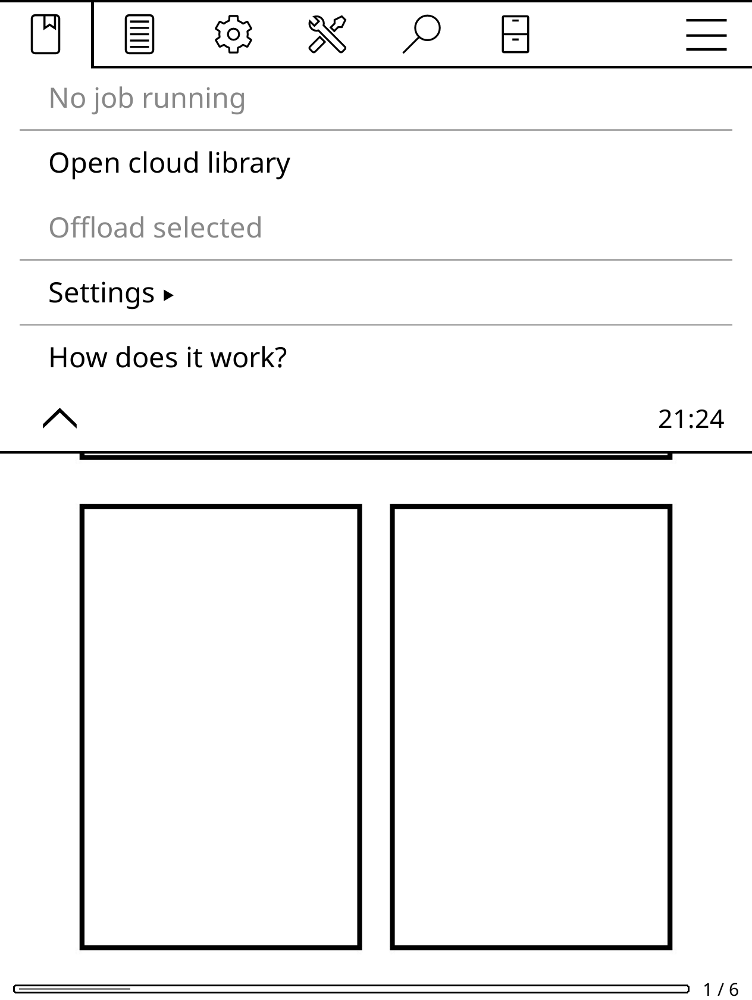

# Drive-Bibliothek für KOReader

*English: [README.md](README.md)*

Google Drive als Cloud-Bibliothek: Bücher und Comics vom Gerät auslagern und bei Bedarf wieder herunterladen. Lesestand und eigene Angaben bleiben erhalten.

## Bildschirmfotos

 
 

## Was es macht

- **In Cloud auslagern:** Lang auf ein Buch oder einen Ordner drücken. Das Plugin lädt die Datei hoch, falls sie noch fehlt, vergleicht die Prüfsumme und löscht sie erst danach vom Gerät.
- **Cloud-Bibliothek:** Werkzeuge → Drive-Bibliothek. Zeigt den Drive-Ordner und bei jedem Buch, ob es nur in der Cloud (☁) oder auch auf dem Gerät (✓) liegt. Antippen lädt es herunter oder öffnet es.
- **Mehrere auf einmal:** Im Auswahl-Modus Bücher markieren, dann Werkzeuge → Drive-Bibliothek → „Ausgewählte auslagern“ oder die Geste dafür.
- **Optional:** Nach dem Schließen eines fertig gelesenen Buchs fragen, ob es ausgelagert werden soll.

Der Ordner in Drive heißt standardmäßig `Kobo Bibliothek`. Seine Unterordner entsprechen denen der lokalen Bibliothek. Lädst du am PC selbst hoch, nimm dieselben Ordnernamen, dann erkennt das Plugin die Dateien und lädt sie nicht doppelt hoch.

## Installation

1. ZIP aus den [Releases](../../releases) laden und entpacken, oder das Projekt herunterladen.
2. Den Ordner **`drivelibrary.koplugin`** nach `koreader/plugins/` kopieren (Kobo: `.adds/koreader/plugins/`).
3. KOReader neu starten und die Einrichtung unten durchgehen.

## Wichtig zu wissen

- **Der `.sdr`-Ordner (Lesestand, eigene Titel, Notizen) geht beim Auslagern mit nach Drive** und bleibt zusätzlich als Sicherheitskopie in `.adds/koreader/drivelibrary/sdr/`. In der Bibliothek bleibt nichts zurück, leere Ordner verschwinden. Beim Herunterladen kommt die `.sdr` zurück; eine vorhandene `.sdr` wird nie überschrieben.
- **Ausgelagerte Bücher fehlen in Bibliothek und Reihen**, bis du sie wieder herunterlädst.
- **Es wird nie etwas überschrieben.** Liegt in Drive eine andere Datei mit demselben Namen, bleibt die lokale Datei liegen und du bekommst eine Meldung.
- **Das Plugin braucht vollen Zugriff auf dein Drive**, sonst sieht es keine Dateien, die du im Browser hochlädst. Es arbeitet nur im gewählten Ordner, das stellt aber nur der Code des Plugins sicher, nicht Google. Geht das Gerät verloren: Zugriff unter myaccount.google.com/permissions entziehen.

## Einrichtung (einmalig)

Jeder braucht ein eigenes kleines Google-Cloud-Projekt. Das ist kostenlos.

1. **Projekt anlegen:** console.cloud.google.com → neues Projekt, z. B. „Kobo Drive“.
2. **API einschalten:** „APIs & Dienste“ → Bibliothek → „Google Drive API“ → Aktivieren.
3. **Zustimmungsbildschirm:** Zielgruppe „Extern“, App-Name und E-Mail eintragen, dann **„App veröffentlichen“ / „In Produktion“**. Im Status „Test“ läuft die Anmeldung nach 7 Tagen ab. Eine Prüfung durch Google ist für den eigenen Gebrauch nicht nötig.
4. **Zugangsdaten:** „Anmeldedaten“ → OAuth-Client-ID → Typ „Webanwendung“. Als autorisierte Weiterleitungs-URI eintragen: `https://developers.google.com/oauthplayground`. Die JSON-Datei herunterladen und `client_id.json` nennen.
5. **Zugang holen:** developers.google.com/oauthplayground öffnen. Oben rechts das Zahnrad → „Use your own OAuth credentials“ → Client-ID und Secret eintragen. Links `https://www.googleapis.com/auth/drive` eintragen, „Authorize APIs“, mit deinem Konto anmelden und die Warnung „Google hat diese App nicht überprüft“ bestätigen (es ist deine eigene App). Dann „Exchange authorization code for tokens“. Den **Refresh token** in eine Textdatei `refresh_token.txt` kopieren.
6. **Auf den Kobo:** Beide Dateien nach `.adds/koreader/drivelibrary/` legen (den Ordner anlegen). **Nicht** in den Plugin-Ordner.
7. **Prüfen:** Werkzeuge → Drive-Bibliothek → Einstellungen → „Anmeldung prüfen“. Der Ordner `Kobo Bibliothek` wird dabei in Drive angelegt, falls er fehlt.

Wird der Zugang länger als 6 Monate nicht benutzt, läuft er ab. Dann Schritt 5 wiederholen und `refresh_token.txt` ersetzen.

## Sicherheit

Die Verbindung zu Google läuft mit geprüftem Zertifikat. `client_id.json` und `refresh_token.txt` sind wie Passwörter: nicht teilen, nicht veröffentlichen.

## Danksagung

Die Idee, den Zugang über den OAuth Playground zu holen, stammt aus [gdrive.koplugin](https://github.com/moohaad/gdrive.koplugin) von moohaad (MIT). Code wurde nicht übernommen.

## Getestet auf

Kobo Libra Colour mit KOReader 2026.07.1 und ZenOS. Die automatischen Tests laufen gegen ein nachgebautes Drive (`tests/fake_drive.py`), dazu wurde alles mit einem echten Drive-Konto von Hand geprüft.

## Wer das gemacht hat

Der Code wurde vollständig von **Claude** geschrieben, einer KI von Anthropic (in Claude Code). Der Besitzer dieses Projekts hatte die Idee, hat das Plugin auf dem Kobo getestet und Rückmeldungen gegeben, aber keinen Code geschrieben.

Es gibt keine Gewährleistung und keinen festen Support. Fehlermeldungen gern als [Issue](../../issues), bitte mit der `crash.log` aus dem KOReader-Ordner. **Vorsicht:** Das Plugin löscht Dateien vom Gerät (erst nach bestandener Prüfsumme). Probiere es zuerst mit Büchern, die du ersetzen kannst.

## Lizenz

[MIT](LICENSE)
