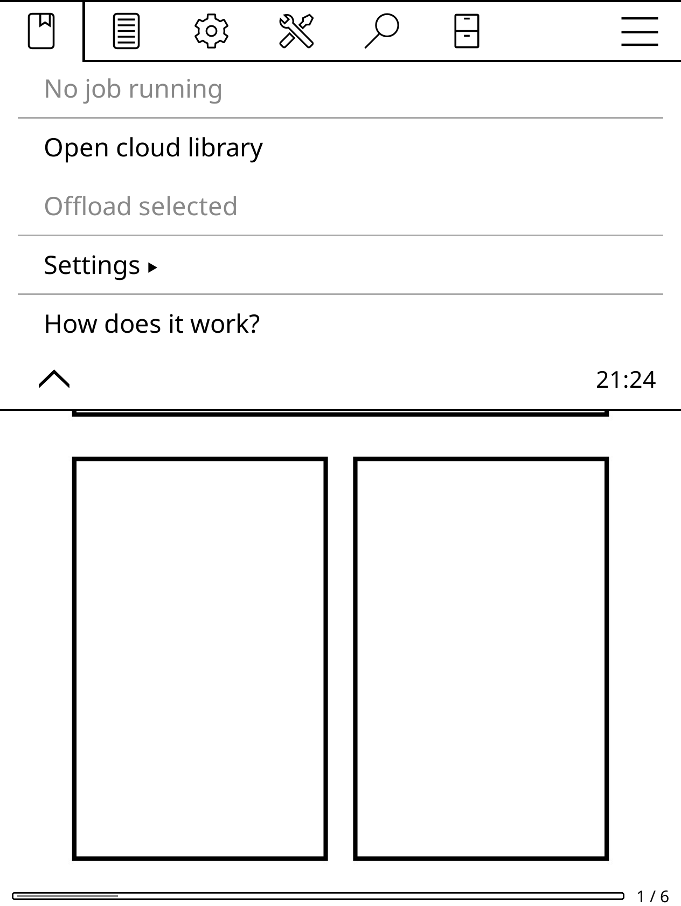
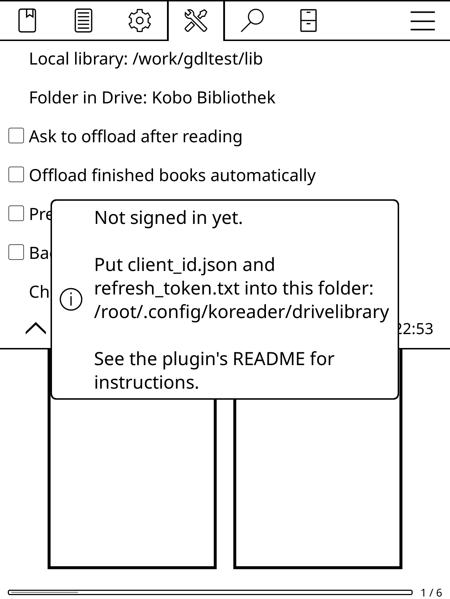
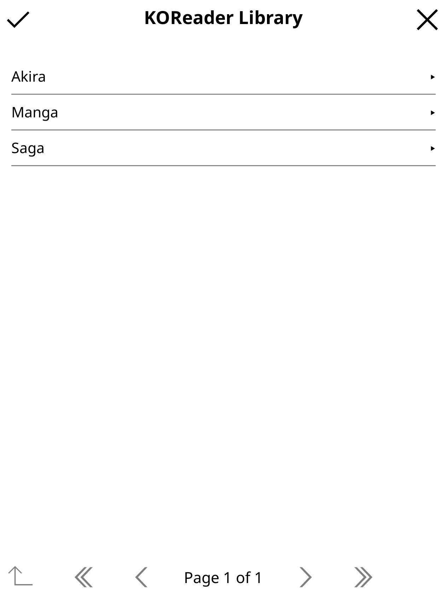
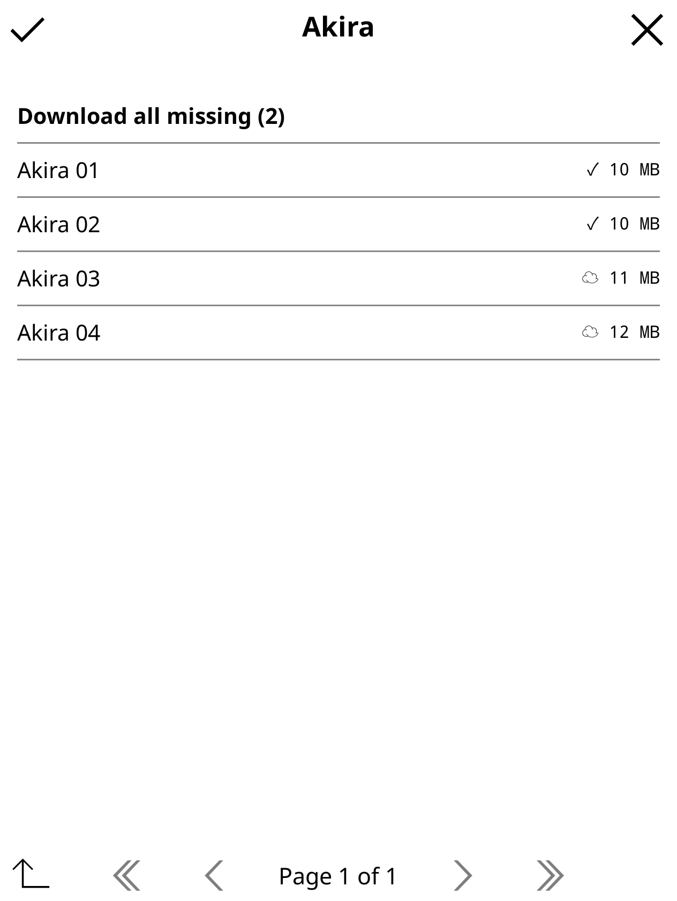
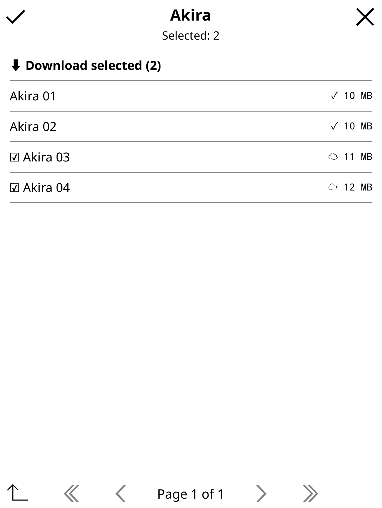
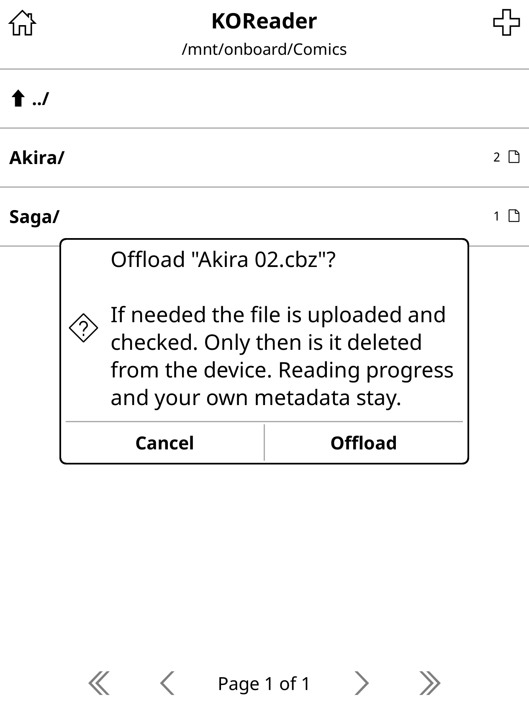
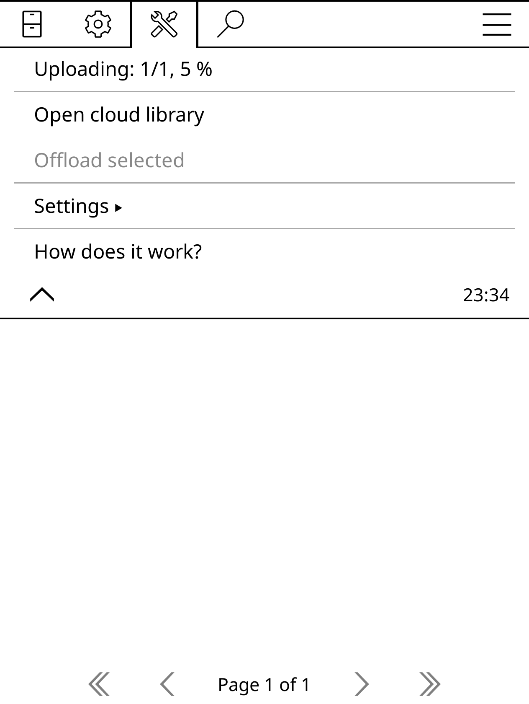
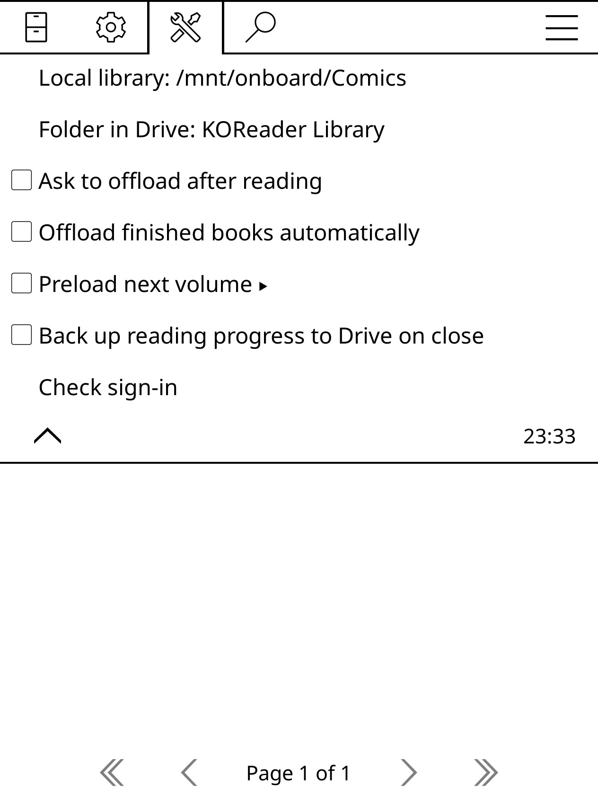
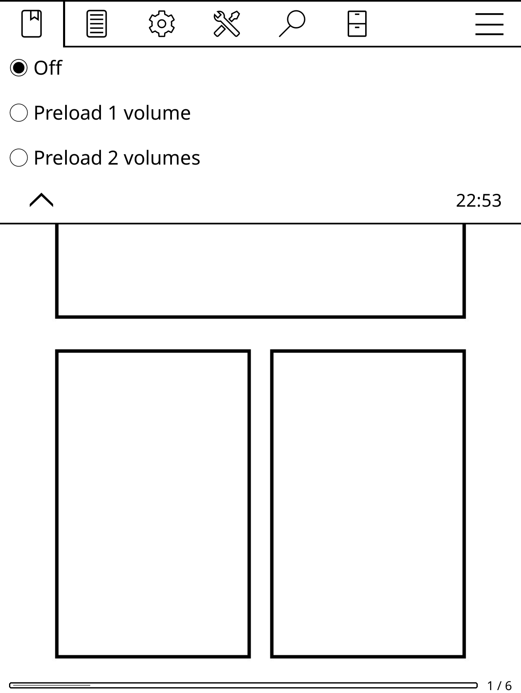

# Drive Library for KOReader

*Deutsch: [README.de.md](README.de.md)*

<!-- lang-note -->
*Works in **English and German**: menus and texts follow KOReader's language. A German description is at the bottom of this page.*

Google Drive as a cloud library: move books and comics off the device and download them again when needed. Reading progress and your own metadata stay intact.

## Screenshots

*The screenshots show the English interface; in a German KOReader the texts are German.*

<table>
<tr><td align="center" valign="top" width="33%"><br><sub>Drive Library menu</sub></td><td align="center" valign="top" width="33%"><br><sub>Message while not signed in yet</sub></td><td align="center" valign="top" width="33%"><br><sub>Help text for download, offload and background jobs</sub></td></tr>
<tr><td align="center" valign="top" width="33%"><br><sub>Cloud library: the Drive folder</sub></td><td align="center" valign="top" width="33%"><br><sub>A series: on the device (check mark) or only in the cloud (cloud icon)</sub></td><td align="center" valign="top" width="33%"><br><sub>Selection mode: download selected</sub></td></tr>
<tr><td align="center" valign="top" width="33%"><br><sub>Confirmation before moving a book to the cloud</sub></td><td align="center" valign="top" width="33%"><br><sub>Status line while uploading</sub></td><td align="center" valign="top" width="33%"><br><sub>Settings</sub></td></tr>
<tr><td align="center" valign="top" width="33%"><br><sub>Preload the next volume: off, 1, 2</sub></td></tr>
</table>

## What it does

- **Move to cloud:** long-press a book or folder. The plugin uploads the file if it is not there yet, compares the checksum and only then deletes it from the device.
- **Cloud library:** Tools → Drive Library. Shows the Drive folder and, for each book, whether it is only in the cloud (☁) or also on the device (✓). Tap to download or open it.
- **Several at once:** mark books in selection mode, then Tools → Drive Library → "Move selected to cloud" (or the gesture for it).
- **Optional:** after closing a finished book, ask whether to move it to the cloud.

Your **local library** is your KOReader home folder, the folder where your books are. You can choose another one under Settings → "Local library".

The Drive folder is called `KOReader Library` by default. Its subfolders mirror the local library. If you upload from a PC yourself, use the same folder names, then the plugin recognises the files and does not upload them twice.

## Good to know

- **The `.sdr` folder (reading progress, custom titles, notes) goes to Drive with the book** and stays as a backup copy in `.adds/koreader/drivelibrary/sdr/`. Nothing stays behind in the library, empty folders disappear. When downloading, the `.sdr` comes back; an existing `.sdr` is never overwritten.
- **Moved-out books are missing from the library and series views** until you download them again.
- **Nothing is ever overwritten.** If Drive holds a different file with the same name, the local file stays and you get a message.
- **The plugin needs full access to your Drive**, otherwise it cannot see files you upload in the browser. It only works inside the chosen folder, but that is guaranteed by the plugin's code, not by Google. If the device is lost: revoke access at myaccount.google.com/permissions.

## Installation

1. Download and unpack the ZIP file from [Releases](../../releases), or download this project.
2. Copy the folder **`drivelibrary.koplugin`** into KOReader's `plugins` folder (on a Kobo, for example, that is `.adds/koreader/plugins/`).
3. Restart KOReader and do the one-time setup below.

## Setup (one time)

You only do this once, on a computer, in about 10 to 15 minutes. At the end you copy **two small files** to your e-reader. Open the three parts one after the other:

| Part | You get |
| --- | --- |
| 1. Create your own Google project | `client_id.json` |
| 2. Allow access to your Drive | `refresh_token.txt` |
| 3. Copy both files to the e-reader | done |

Everything is free. The project is your own, so nobody else gets access to your Drive.

<details>
<summary><b>Part 1: Create your Google project</b> (you get <code>client_id.json</code>)</summary>

Sign in with the Google account whose Drive you want to use.

**1. New project**
- Open [console.cloud.google.com/projectcreate](https://console.cloud.google.com/projectcreate)
- **Project name:** `KOReader Drive` → **Create**
- Make sure this project is selected at the top of the page from now on.

**2. Switch on Google Drive**
- Open [the Google Drive API page](https://console.cloud.google.com/apis/library/drive.googleapis.com)
- **Enable**

**3. Describe your app**
- Open [Google Auth Platform](https://console.cloud.google.com/auth/overview) → **Get started**
- **App Information:** App name `KOReader Drive`, your email as **User support email** → **Next**
- **Audience:** **External** → **Next**
- **Contact Information:** your email → **Next**
- **Finish:** agree to the user data policy → **Continue** → **Create**

**4. Publish the app**
- Open [Audience](https://console.cloud.google.com/auth/audience) → **Publish app** → confirm
- The publishing status now says **In production**

> Don't skip this. In "Testing" status your sign-in stops working after 7 days. For your own use you don't need Google's review.

**5. Create the first file**
- Open [Clients](https://console.cloud.google.com/auth/clients) → **Create client**
- **Application type:** **Web application**
- Under **Authorised redirect URIs** → **Add URI**, paste exactly:
  ```
  https://developers.google.com/oauthplayground
  ```
- **Create**
- **Download the JSON file right away** and rename it to `client_id.json`. Google shows the secret key only this one time.

</details>

<details>
<summary><b>Part 2: Allow access to your Drive</b> (you get <code>refresh_token.txt</code>)</summary>

This uses a Google tool called "OAuth 2.0 Playground". The change from step 5 can take 5 minutes (sometimes a few hours) to work.

**6. Enter your own client**
- Open [developers.google.com/oauthplayground](https://developers.google.com/oauthplayground)
- **Gear icon** (top right) → tick **Use your own OAuth credentials**
- Fill in **OAuth Client ID** and **OAuth Client secret**. Both are in your `client_id.json` (open it with a text editor).

**7. Allow access**
- Bottom left, into **Input your own scopes**, paste:
  ```
  https://www.googleapis.com/auth/drive
  ```
- **Authorize APIs** and sign in
- Google warns that it has not verified the app. That is expected, it is your own app: **Advanced** → continue → allow

**8. Create the second file**
- **Exchange authorization code for tokens**
- Copy the **Refresh token** (only this one, not the access token)
- Paste it into a new text file and save it as `refresh_token.txt`

</details>

<details>
<summary><b>Part 3: Copy to the e-reader and test</b></summary>

**9. Put both files into a new folder `drivelibrary`** inside KOReader's folder. On a Kobo, KOReader's folder is `.adds/koreader/` (hidden folder).

```
koreader/
├── drivelibrary/                ← create this folder
│   ├── client_id.json
│   └── refresh_token.txt
└── plugins/
    └── drivelibrary.koplugin/   ← the plugin (see Installation)
```

The two files do **not** go into the plugin folder.

**10. Test it**
- Restart KOReader and connect to Wi-Fi
- Tools → **Drive Library** → **Settings** → **Check sign-in**
- The folder `KOReader Library` is now created in your Drive, if it is missing. Done!

</details>

<details>
<summary><b>Something does not work?</b></summary>

| Problem | Solution |
| --- | --- |
| "Not signed in yet" | Check the folder name, both file names and the location (not inside the plugin folder). On Windows, make sure the file is not called `refresh_token.txt.txt`. |
| `redirect_uri_mismatch` in the Playground | The address in step 5 is missing, has a typo, or is not active yet. Wait a little. |
| You closed the window without downloading the JSON file | Create a new client (step 5). |
| Stops working after 7 days | The app was not published (step 4). Publish it, then repeat steps 6 to 8. |
| Stops working after months without use | Unused access expires after 6 months. Repeat steps 6 to 8 and replace `refresh_token.txt`. |

</details>

## Security

The connection to Google uses a verified certificate. `client_id.json` and `refresh_token.txt` are like passwords: do not share or publish them.

## Tested on

Kobo Libra Colour with KOReader 2026.07.1 and ZenOS. The automated tests run against a replica of Drive (`tests/fake_drive.py`); everything was also checked by hand with a real Drive account.

## Who made this

The code was written entirely by **Claude**, an AI by Anthropic (in Claude Code). The owner of this project had the idea, tested the plugin on the Kobo and gave feedback, but did not write any code.

There is no warranty and no fixed support. Bug reports are welcome as an [issue](../../issues), please attach the `crash.log` from the KOReader folder. **Careful:** the plugin deletes files from the device (only after the checksum matched). Try it with books you can replace first.

## Credits

The idea of getting access through the OAuth Playground comes from [gdrive.koplugin](https://github.com/moohaad/gdrive.koplugin) by moohaad (MIT). No code was taken.

## More plugins

- [Comic Display](https://github.com/Akrota/koreader-comic-display): Refresh against ghosting, dark borders and a clock for comics
- [Levels / Tonwerte](https://github.com/Akrota/koreader-comic-levels): Tone curve for comics
- [Comic Panel Zoom](https://github.com/Akrota/koreader-comic-panel-zoom): Panel-by-panel view (fork of JorgeTheFox's plugin)
- [Comic Dual Page](https://github.com/Akrota/koreader-comic-dual-page): Double pages with detection (fork of KORComic)
- [CBZ Converter](https://github.com/Akrota/koreader-cbz-converter): Convert comics, PDF and EPUB to CBZ on the device
- [Folder to series](https://github.com/Akrota/koreader-folder-to-series): Comic folders to series with volume numbers
- [Story Recall](https://github.com/Akrota/koreader-story-recall): Spoiler-free AI recap for books
- [Guitar Tab Reader](https://github.com/Akrota/koreader-guitar-tab-reader): Guitar tabs and chords for e-ink
- [Wi-Fi while charging](https://github.com/Akrota/koreader-wifi-while-charging): Keep Wi-Fi on while charging
- [Zen page browser gesture](https://github.com/Akrota/koreader-zen-page-browser-gesture): Gesture for the ZenOS page browser

## License

[MIT](LICENSE)

---

## Deutsch (Kurzbeschreibung)

Google Drive als Cloud-Bibliothek: Bücher und Comics vom Gerät auslagern und bei Bedarf wieder herunterladen. Lesestand und eigene Angaben bleiben erhalten.


### Was es macht

- **In Cloud auslagern:** Lang auf ein Buch oder einen Ordner drücken. Das Plugin lädt die Datei hoch, falls sie noch fehlt, vergleicht die Prüfsumme und löscht sie erst danach vom Gerät.
- **Cloud-Bibliothek:** Werkzeuge → Drive-Bibliothek. Zeigt den Drive-Ordner und bei jedem Buch, ob es nur in der Cloud (☁) oder auch auf dem Gerät (✓) liegt. Antippen lädt es herunter oder öffnet es.
- **Mehrere auf einmal:** Im Auswahl-Modus Bücher markieren, dann Werkzeuge → Drive-Bibliothek → „Ausgewählte auslagern“ oder die Geste dafür.
- **Optional:** Nach dem Schließen eines fertig gelesenen Buchs fragen, ob es ausgelagert werden soll.

Deine **lokale Bibliothek** ist dein KOReader-Home-Ordner, also der Ordner, in dem deine Bücher liegen. Unter Einstellungen → „Lokale Bibliothek“ kannst du einen anderen wählen.

Der Ordner in Drive heißt standardmäßig `KOReader Library`. Seine Unterordner entsprechen denen der lokalen Bibliothek. Lädst du am PC selbst hoch, nimm dieselben Ordnernamen, dann erkennt das Plugin die Dateien und lädt sie nicht doppelt hoch.

### Wichtig zu wissen

- **Der `.sdr`-Ordner (Lesestand, eigene Titel, Notizen) geht beim Auslagern mit nach Drive** und bleibt zusätzlich als Sicherheitskopie in `.adds/koreader/drivelibrary/sdr/`. In der Bibliothek bleibt nichts zurück, leere Ordner verschwinden. Beim Herunterladen kommt die `.sdr` zurück; eine vorhandene `.sdr` wird nie überschrieben.
- **Ausgelagerte Bücher fehlen in Bibliothek und Reihen**, bis du sie wieder herunterlädst.
- **Es wird nie etwas überschrieben.** Liegt in Drive eine andere Datei mit demselben Namen, bleibt die lokale Datei liegen und du bekommst eine Meldung.
- **Das Plugin braucht vollen Zugriff auf dein Drive**, sonst sieht es keine Dateien, die du im Browser hochlädst. Es arbeitet nur im gewählten Ordner, das stellt aber nur der Code des Plugins sicher, nicht Google. Geht das Gerät verloren: Zugriff unter myaccount.google.com/permissions entziehen.

Die ausführliche deutsche Anleitung steht in der [README.de.md](README.de.md).
