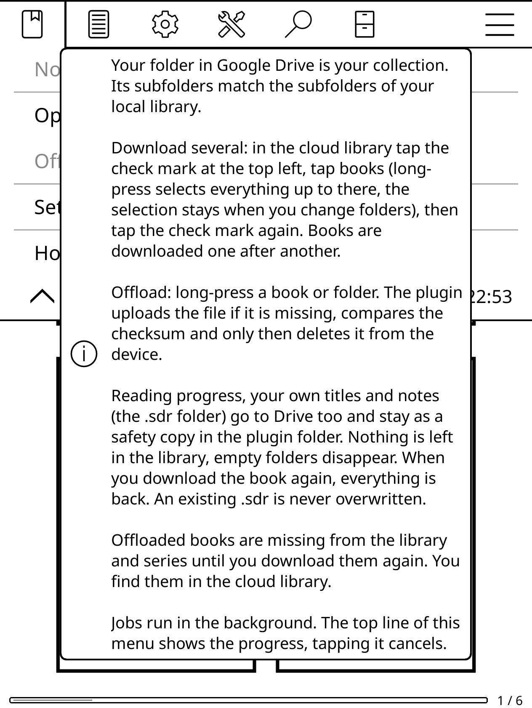

# Drive Library for KOReader

*Deutsch: [README.de.md](README.de.md)*

<!-- lang-note -->
*Works in **English and German**: menus and texts follow KOReader's language. A German description is at the bottom of this page.*

Google Drive as a cloud library: move books and comics off the device and download them again when needed. Reading progress and your own metadata stay intact.

## Screenshots

*The screenshots show the English interface; in a German KOReader the texts are German.*

<table>
<tr><td align="center" valign="top" width="33%"> Drive Library menu</td><td align="center" valign="top" width="33%"> Message while not signed in yet</td><td align="center" valign="top" width="33%"> Help text for download, offload and background jobs</td></tr>
<tr><td align="center" valign="top" width="33%"> Cloud library: the Drive folder</td><td align="center" valign="top" width="33%"> A series: on the device (check mark) or only in the cloud (cloud icon)</td><td align="center" valign="top" width="33%"> Selection mode: download selected</td></tr>
<tr><td align="center" valign="top" width="33%"> Confirmation before moving a book to the cloud</td><td align="center" valign="top" width="33%"> Status line while uploading</td><td align="center" valign="top" width="33%"> Settings</td></tr>
<tr><td align="center" valign="top" width="33%"> Preload the next volume: off, 1, 2</td></tr>
</table>

## What it does

- **Move to cloud:** long-press a book or folder. The plugin uploads the file if it is not there yet, compares the checksum and only then deletes it from the device.
- **Cloud library:** Tools → Drive Library. Shows the Drive folder and, for each book, whether it is only in the cloud (☁) or also on the device (✓). Tap to download or open it.
- **Several at once:** mark books in selection mode, then Tools → Drive Library → "Move selected to cloud" (or the gesture for it).
- **Optional:** after closing a finished book, ask whether to move it to the cloud.

The Drive folder is called `KOReader Library` by default. Its subfolders mirror the local library. If you upload from a PC yourself, use the same folder names, then the plugin recognises the files and does not upload them twice.

## Good to know

- **The `.sdr` folder (reading progress, custom titles, notes) goes to Drive with the book** and stays as a backup copy in `.adds/koreader/drivelibrary/sdr/`. Nothing stays behind in the library, empty folders disappear. When downloading, the `.sdr` comes back; an existing `.sdr` is never overwritten.
- **Moved-out books are missing from the library and series views** until you download them again.
- **Nothing is ever overwritten.** If Drive holds a different file with the same name, the local file stays and you get a message.
- **The plugin needs full access to your Drive**, otherwise it cannot see files you upload in the browser. It only works inside the chosen folder, but that is guaranteed by the plugin's code, not by Google. If the device is lost: revoke access at myaccount.google.com/permissions.

## Installation

1. Download and unpack the ZIP file from [Releases](../../releases), or download this project.
2. Copy the folder **`drivelibrary.koplugin`** into KOReader's `plugins` folder (Kobo: `.adds/koreader/plugins/`).
3. Restart KOReader and do the one-time setup below.

## Setup (one time)

Everyone needs their own small Google Cloud project. It is free.

1. **Create a project:** console.cloud.google.com → new project, e.g. "KOReader Drive".
2. **Enable the API:** "APIs & Services" → Library → "Google Drive API" → Enable.
3. **Consent screen:** audience "External", enter app name and email, then **"Publish app" / "In production"**. In "Testing" status the sign-in expires after 7 days. A review by Google is not needed for personal use.
4. **Credentials:** "Credentials" → OAuth client ID → type "Web application". Add `https://developers.google.com/oauthplayground` as an authorised redirect URI. Download the JSON file and name it `client_id.json`.
5. **Get access:** open developers.google.com/oauthplayground. Gear icon at the top right → "Use your own OAuth credentials" → enter client ID and secret. On the left enter `https://www.googleapis.com/auth/drive`, "Authorize APIs", sign in with your account and confirm the "Google hasn't verified this app" warning (it is your own app). Then "Exchange authorization code for tokens". Copy the **refresh token** into a text file named `refresh_token.txt`.
6. **Onto the Kobo:** put both files into `.adds/koreader/drivelibrary/` (create the folder). **Not** into the plugin folder.
7. **Check:** Tools → Drive Library → Settings → "Check sign-in". This also creates the `KOReader Library` folder in Drive if it is missing.

If the access is not used for more than 6 months it expires. Repeat step 5 and replace `refresh_token.txt`.

## Security

The connection to Google uses a verified certificate. `client_id.json` and `refresh_token.txt` are like passwords: do not share or publish them.

## Tested on

Kobo Libra Colour with KOReader 2026.07.1 and ZenOS. The automated tests run against a replica of Drive (`tests/fake_drive.py`); everything was also checked by hand with a real Drive account.

## Who made this

The code was written entirely by **Claude**, an AI by Anthropic (in Claude Code). The owner of this project had the idea, tested the plugin on the Kobo and gave feedback, but did not write any code.

There is no warranty and no fixed support. Bug reports are welcome as an [issue](../../issues), please attach the `crash.log` from the KOReader folder. **Careful:** the plugin deletes files from the device (only after the checksum matched). Try it with books you can replace first.

## Credits

The idea of getting access through the OAuth Playground comes from [gdrive.koplugin](https://github.com/moohaad/gdrive.koplugin) by moohaad (MIT). No code was taken.

## More plugins

- [Comic Display](https://github.com/Akrota/koreader-comic-display): Refresh against ghosting, dark borders and a clock for comics
- [Levels / Tonwerte](https://github.com/Akrota/koreader-comic-levels): Tone curve for comics
- [Comic Panel Zoom](https://github.com/Akrota/koreader-comic-panel-zoom): Panel-by-panel view (fork of JorgeTheFox's plugin)
- [Comic Dual Page](https://github.com/Akrota/koreader-comic-dual-page): Double pages with detection (fork of KORComic)
- [CBZ Converter](https://github.com/Akrota/koreader-cbz-converter): Convert comics, PDF and EPUB to CBZ on the device
- [Folder to series](https://github.com/Akrota/koreader-folder-to-series): Comic folders to series with volume numbers
- [Story Recall](https://github.com/Akrota/koreader-story-recall): Spoiler-free AI recap for books
- [Guitar Tab Reader](https://github.com/Akrota/koreader-guitar-tab-reader): Guitar tabs and chords for e-ink
- [Wi-Fi while charging](https://github.com/Akrota/koreader-wifi-while-charging): Keep Wi-Fi on while charging
- [Zen page browser gesture](https://github.com/Akrota/koreader-zen-page-browser-gesture): Gesture for the ZenOS page browser

## License

[MIT](LICENSE)

---

## Deutsch (Kurzbeschreibung)

Google Drive als Cloud-Bibliothek: Bücher und Comics vom Gerät auslagern und bei Bedarf wieder herunterladen. Lesestand und eigene Angaben bleiben erhalten.

### Was es macht

- **In Cloud auslagern:** Lang auf ein Buch oder einen Ordner drücken. Das Plugin lädt die Datei hoch, falls sie noch fehlt, vergleicht die Prüfsumme und löscht sie erst danach vom Gerät.
- **Cloud-Bibliothek:** Werkzeuge → Drive-Bibliothek. Zeigt den Drive-Ordner und bei jedem Buch, ob es nur in der Cloud (☁) oder auch auf dem Gerät (✓) liegt. Antippen lädt es herunter oder öffnet es.
- **Mehrere auf einmal:** Im Auswahl-Modus Bücher markieren, dann Werkzeuge → Drive-Bibliothek → „Ausgewählte auslagern“ oder die Geste dafür.
- **Optional:** Nach dem Schließen eines fertig gelesenen Buchs fragen, ob es ausgelagert werden soll.

Der Ordner in Drive heißt standardmäßig `KOReader Library`. Seine Unterordner entsprechen denen der lokalen Bibliothek. Lädst du am PC selbst hoch, nimm dieselben Ordnernamen, dann erkennt das Plugin die Dateien und lädt sie nicht doppelt hoch.

### Wichtig zu wissen

- **Der `.sdr`-Ordner (Lesestand, eigene Titel, Notizen) geht beim Auslagern mit nach Drive** und bleibt zusätzlich als Sicherheitskopie in `.adds/koreader/drivelibrary/sdr/`. In der Bibliothek bleibt nichts zurück, leere Ordner verschwinden. Beim Herunterladen kommt die `.sdr` zurück; eine vorhandene `.sdr` wird nie überschrieben.
- **Ausgelagerte Bücher fehlen in Bibliothek und Reihen**, bis du sie wieder herunterlädst.
- **Es wird nie etwas überschrieben.** Liegt in Drive eine andere Datei mit demselben Namen, bleibt die lokale Datei liegen und du bekommst eine Meldung.
- **Das Plugin braucht vollen Zugriff auf dein Drive**, sonst sieht es keine Dateien, die du im Browser hochlädst. Es arbeitet nur im gewählten Ordner, das stellt aber nur der Code des Plugins sicher, nicht Google. Geht das Gerät verloren: Zugriff unter myaccount.google.com/permissions entziehen.

Die ausführliche deutsche Anleitung steht in der [README.de.md](README.de.md).
